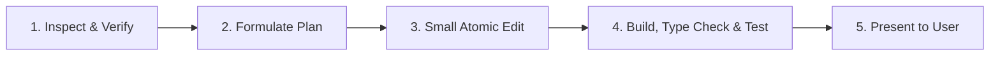

# AGENTS.md — Development Guidelines & Best Practices for AI Agents

Welcome to the **ShoeDZ (Pointure)** repository. This document defines the operational rules, engineering standards, and task-handling protocols for AI agents and human developers collaborating on this project.

---

## 1. Core Principles (Top Priorities)

> [!IMPORTANT]
> **1. Small, Incremental Changes Only**
> Never perform wide, sweeping refactors or multi-screen rewrites in a single step. Break every feature, fix, or enhancement into small, self-contained, reviewable units.
>
> **2. Strictly NO Auto-Commits**
> **NEVER** run `git commit`, `git tag`, or `git push` automatically or proactively. Git commits and version tags must only be created when the user explicitly requests them. Always leave modified files staged or unstaged in the working tree for the user's review unless instructed otherwise.
>
> **3. Strict Internationalization (i18n): Zero Hardcoded Strings**
> **NEVER** hardcode raw user-visible text in components, pages, forms, or modals. Every string displayed to the user must use `useTranslation()` (`t("section.key", "Default Fallback")`). Whenever UI is added or modified, all three locale files (`fr.json`, `ar.json`, `en.json`) must be updated and kept synchronized, with appropriate RTL translations for Arabic. **Every key you reference must exist in all three files. The fallback text is not a substitute.**
>
> **4. Verify, Never Assume**
> Every import, model, field, method, component prop, context value, URL route and setting you reference **must exist in the current code**. Open the definition before using it. Most bugs found in the 2026 audit were references to things that did not exist:
> - imports of models that were never defined;
> - an `invoice.recalculate_totals()` method that was never written;
> - `ClientLedger(tenant=…, reference_number=…)`, fields the model doesn't have;
> - `useBranch().selectedBranch`, a context value that doesn't exist;
> - `<ManagerPinModal onClose=…>`, a prop the component doesn't declare.
>
> **5. Report Honestly**
> Paste the real output of your checks. If a check could not run, say so. Never describe a file as created or committed without confirming it with `git status`; see §6, because `.gitignore` ignores `*.md`.

---

## 2. Task Approach Protocol

Every task assigned to an agent must follow this lifecycle:



1. **Inspect & Verify**:
   - Read the relevant files before writing or suggesting code, including the `save()` methods and signals of any model you write to (§4.3).
   - Search existing components and utilities to avoid reinventing already existing helpers (e.g., `@/lib/api`, `@/lib/phone`, `@/lib/printerConfig`, `@/lib/wilayas`).
2. **Formulate a Clear Plan**:
   - Break complex tasks into distinct phases or steps.
   - For multi-phase work, align with the user before touching code.
   - When working from `docs/plans/`, follow the task order and the decisions tables. If a needed decision is missing, stop and ask.
3. **Small Atomic Edits**:
   - Focus on one component, view, or endpoint at a time.
   - Preserve existing docstrings, comments, and unrelated functionality.
4. **Build, Type Check & Test** (commands in §2.1; all must pass).
5. **Present & Review**:
   - Provide clickable file links using `[filename](file:///path/to/file)`.
   - Summarize exact changes concisely, with the test and check output.
   - Ask for confirmation before moving to subsequent steps.

### 2.1 Verification Commands

```bash
# Frontend: type check, tests, build (the build also type-checks)
npm run typecheck --prefix frontend
npm test --prefix frontend
npm run build --prefix frontend

# Backend: run from backend/ with the project venv.
# pytest uses config.settings.test (SQLite, temporary data dir, no Docker or Postgres).
cd backend
venv/bin/python manage.py check --settings=config.settings.desktop
venv/bin/python manage.py makemigrations --check --dry-run --settings=config.settings.desktop
venv/bin/python -m pytest -p no:cacheprovider -q
```

> [!WARNING]
> **Never run `npx tsc …` from the repository root.** TypeScript isn't installed there, so `npx` silently downloads an unrelated npm package named `tsc` that exits 0 without checking anything. Use `npm run typecheck --prefix frontend`, or `cd frontend && npx tsc --noEmit`.

- `npm run lint` currently has **no ESLint config**, so don't report lint as passing.
- Docker and `make` targets belong to the dormant server deployment and are not needed for desktop work.

---

## 3. Product Context

- **What ships:** the **Windows desktop app** only. Electron (`desktop/`) spawns an embedded Django backend (Waitress + SQLite, settings `config.settings.desktop`) on `127.0.0.1:8745`, which also serves the built React SPA.
- **Who uses it:** a pilot store runs it **with real data**. There is no live cloud deployment.
- **Dormant code:** the cloud, Docker, mobile and delivery-integration code is inactive. Don't extend it unless the task explicitly asks.
- **Offline-first:** every feature must work without internet. Anything that uses the network must queue and retry, and must never block or fail a user request.
- **SQLite allows one writer at a time:** keep transactions short. No network calls, file I/O or long loops inside `transaction.atomic()`.
- **Low-spec hardware (about 4 GB RAM):** avoid N+1 queries and loading whole tables into Python.

---

## 4. Architecture & Domain Guidelines

### 4.1 Footwear Retail Domain (Algerian Context)
- **Currency & Numbers**: All prices are in Algerian Dinars (`DZD`). Use standard formatters (`formatDZD()` in `frontend/src/lib/api.ts`).
- **Phone Numbers**: Primary identifier for authentication and clients. Must adhere to standard Algerian mobile formats (`05`, `06`, `07`, or international `+213`). Always use `@/lib/phone` on frontend and `apps.core.utils.phone` on backend.
- **Footwear Sizing**: Sizes are EU standards (typically 35–46). Footwear can be sold by individual pairs (*rayon*) or complete cartons (*gros / demi-gros*).
- **Wilayas**: Support for 58 Algerian wilayas with both French and Arabic designations.

### 4.2 Multi-Tenancy
- Every business model belongs to a `Tenant`. Always scope queries to the request's tenant, and never allow cross-tenant data leaks.
- **`TenantManager` only filters inside `TenantScopedViewSetMixin` views.** In a plain `APIView`, management command, scheduler job or Celery/`run_task` task, no tenant is set and `Model.objects` returns **every tenant's rows**. Filter with `tenant=` explicitly there.
- `ClientLedger`, `SaleItem`, `InvoiceLine`, `DeliveryNoteLine` and `POLine` are **not** tenant-scoped models. Scope them through their parent (`client__tenant=…`, `sale__tenant=…`).

### 4.3 Side Effects: Read These Before Writing Data
Many saves trigger other writes. Check this table, the model's `save()` and `apps/*/signals.py` before adding any ledger, stock or balance entry.

| When you save… | It also… |
|---|---|
| a new `StockMovement` | recomputes `Variant.stock_qty` from the whole ledger (`Variant.refresh_stock`) |
| an `Invoice` | recomputes totals and updates the client-ledger debit (`_sync_client_ledger`) |
| an `InvoicePayment` | updates the invoice status **and writes a client-ledger credit** |
| a `CreditNote` | writes a client-ledger credit |
| a `SupplierInvoice` / `SupplierPayment` (save or delete) | recomputes `Supplier.outstanding_balance` (signals) |
| a `Sale` | publishes a live event (on create) and enqueues webhook deliveries |
| a new `Client` | auto-enrolls the client in loyalty |
| any model in `AUDITED_MODELS` | writes an `AuditLog` row (and re-reads the row first) |
| any `TenantScopedModel` | writes a `SyncOutbox` row |

**One real-world event = exactly one ledger entry and one stock movement per line.** The 2026 audit found client payments credited twice: once in the view, and again in `InvoicePayment.save()`.

### 4.4 Financial & Stock Invariants
- **Money:** `Decimal` everywhere, never `float`. DZD amounts are quantized to `0.01`.
- **Stock and system fields:** stock changes **only** through `StockMovement` rows. Never set `stock_qty`, totals, balances, `cash_gap`/`system_*` or statuses from request data. Declare such fields in the serializer's `read_only_fields`.
- **Atomic, locked, idempotent:** stock, money and payment operations run inside `transaction.atomic()`. Lock the rows you check and then update (`select_for_update()`), and re-check their state after locking. A double click or retried request must not deduct, restore or credit twice.
- **Status changes:** use the model's transition methods (e.g. `Invoice.confirm()`) instead of assigning `status`. They carry numbering, stock and ledger effects.
- **Reversals:** every cancel or reversal undoes **all** effects of the original (stock, ledger, loyalty, cheques), or explicitly refuses.
- **Validated values must be saved:** a business value computed in `validate()` (e.g. stamp duty) must come from the same helper in `create()` **and be persisted**.
- **Totals:** the server computes totals, refunds and credit amounts from the lines. Client-sent totals are only cross-checked.
- **Document numbers:** use a counter row locked with `select_for_update()` (see `InvoiceCounter.next_number`). Never "max + 1".
- **Business dates:** use `timezone.localdate()` / `timezone.now()` (Africa/Algiers), not `datetime.date.today()` or `datetime.now()`.

### 4.5 Permissions & Roles
- Respect the role hierarchy (`owner`, `manager`, `cashier`).
- **Enforce roles on the server** for every create, update, delete and custom action. Hiding a button is not security.
- `ModelViewSet` exposes PUT, PATCH and DELETE by default. Restrict them, or remove them with `http_method_names`, when they are not intended.
- **Cashier scope:** POS sales, their own cash session, returns and discounts within their user flags (`can_process_returns`, `max_discount_pct`, `can_modify_price`, `can_cancel_sale`), and client contact info. Everything else needs manager or owner (see the role matrix in `docs/plans/v1.6-plan.md`, Task 2.1).
- **Manager-PIN overrides** record who authorized them and are rate-limited.
- Frontend routes and keyboard shortcuts apply the same role rules as the sidebar.

### 4.6 API Conventions
- **IDs:** business-model primary keys are UUIDs. Route params use `<uuid:pk>` or `[0-9a-f-]+`, never `\d+`, and never call `int()` on an id.
- **Input parsing:** use serializer fields (`BooleanField`, `DecimalField`, `DateField`, `ChoiceField`). Never `bool(request.data.get(...))`: the string `"false"` is truthy.
- **Error shape:** `apps.core.exceptions.custom_exception_handler` wraps every error as `{"error": {"code", "message", "details", "status_code"}}`. The frontend reads errors with `getApiError()` (`frontend/src/lib/api.ts`). When matching a specific error code, read the wrapped shape.
- **Error messages:** never return `str(e)` to the client. Log the exception and return a translated message.
- **Frontend requests:** all go through the shared `api` instance. Never build base URLs by hand; doing so produced a `/api/api/v1` bug.

### 4.7 Background Work & External Calls
- **Optional side effects run after commit:** PDF generation, notifications, webhooks and events run via `transaction.on_commit(lambda: run_task(task, ...))` (`apps/core/utils/task_runner.py`). Their failure is logged and must never roll back or fail the user's request.
- **Why this matters on desktop:** Celery runs eagerly with errors propagated, so a `.delay()` inside `atomic()` executes synchronously in the request.
- **Outbound HTTP:** every call has an explicit `timeout=` and is never made inside `transaction.atomic()`.
- **Exceptions inside `atomic()`:** never catch an exception there just to continue. If a sub-step may fail, give it its own nested `transaction.atomic()` (savepoint).
- **Desktop jobs** run in `apps/core/desktop/scheduler.py`. The process restarts with the app, so persist last-run times. Measure intervals with `time.monotonic()`.

### 4.8 Migrations (the desktop app auto-migrates real data)
- Migrations run **automatically at app start on the store's existing SQLite database**. A broken migration stops the store from opening the app.
- Never edit or delete an existing migration.
- New fields are nullable or have a default.
- Data migrations are idempotent, batched, SQLite-compatible, and have a reverse (or `migrations.RunPython.noop`).
- Run `makemigrations --check`, and keep to one migration per task where possible.

### 4.9 Frontend Standards (React + TypeScript + Vite + Tailwind CSS)
- **Dark Mode Support**:
  - Every component must support both light and dark themes.
  - Follow the project color scheme: dark surfaces use `dark:bg-slate-900` and `dark:bg-slate-950`, dark borders use `dark:border-slate-800`, and muted text uses `dark:text-slate-400`.
  - Avoid hardcoded white backgrounds (`bg-white` must be paired with an appropriate `dark:bg-...`).
- **Internationalization (i18n)**:
  - Three languages supported: French (`fr`, default), Arabic (`ar`, RTL), and English (`en`).
  - Text strings must use `useTranslation()` (`t("key")`). Every key must exist in all three locale files.
  - Backend user-facing messages use `gettext` (`_()`).
- **Tailwind & UI**:
  - Prefer standard utility classes (`btn-primary`, `card`, `form-input`, `form-label`).
  - Maintain clean spacing, proper focus states (`focus-visible:ring-2`), and mobile/desktop responsiveness.
- **Shared components and contexts:** open them before use and pass their exact props and values (`ManagerPinModal` takes `isOpen`/`onCancel`; `useBranch()` exposes `currentBranch`). Don't silence type errors with `any`, `as never` or `@ts-ignore`.
- **One source of truth for business rules:** TVA, stamp duty, cart math and pricing live in **one** frontend helper, mirrored by exactly one backend helper. Never copy them into a page.
- **Shared queries:** fetch shared data such as `["store-settings"]` through a shared hook (e.g. `useBusinessMode`), not a new `useQuery` in every page.
- **No monolith growth:** don't add more code to `SalesPage.tsx`, `SettingsPage.tsx`, `StocktakePage.tsx` or `ReconciliationPage.tsx`. Put new UI in a new component file and wire it in.
- **Printing:**
  - Any data interpolated into HTML strings (receipts, part-payment slips, labels, print popups) must go through an HTML-escaping helper: `escapeHtml()` in `frontend/src/lib/utils.ts`, created if it doesn't exist yet.
  - For new printing, use the `printerConfig.ts` helpers, not `window.open` + `document.write`.
- **No backup copies:** don't leave files like `*.bak` or `*.old` in the repo.

### 4.10 Desktop & Hardware Integration (Windows Standalone)
- **Hardware Agnostic**:
  - Support both direct ESC/POS thermal printing (80mm/58mm via USB/network) and standard Windows OS printer dialogs.
  - Test print helpers are centralized in [`frontend/src/lib/printerConfig.ts`](file:///Users/admin/Github/pointure/frontend/src/lib/printerConfig.ts).
- **Barcode Scanners**:
  - Support standard USB HID keyboard-wedge scanners (instant barcode input followed by Enter).
- **Keyboard shortcuts:** check `hooks/useGlobalShortcuts.ts` and the `before-input-event` handler in `desktop/main.js` for conflicts. Document every new shortcut in `ShortcutsModal.tsx`.

### 4.11 Security
- **No new `AllowAny` endpoint** without explicit user approval.
- **Inbound webhooks** verify a signature or secret. Secret checks **fail closed**: `if not expected or provided != expected: reject`, never `if expected and provided != expected`.
- **Never log or return** tokens, passwords, API keys or customer data.
- **`LEGACY/`** contains a real store's data (git-ignored). Never copy it into tests, fixtures, logs or commits; build synthetic fixtures instead.
- **Dormant integrations** (dzship, Meta/Gemini, mobile push, cloud sync) stay behind their feature flags.

### 4.12 Dependencies
- **Ask before adding any Python or npm dependency.**
- Desktop Python packages go in `backend/requirements-desktop.txt`. They must install on the embedded Windows Python 3.12: pure-Python, or with Windows wheels for both x64 and ia32.

---

## 5. Testing Rules

- **Bug fixes:** every bug fix adds a test that **fails before the fix**.
- **New endpoints and actions:** test the happy path, a permission denial (cashier → 403) and invalid input.
- **Execute every new code path,** including inline imports inside branches. Python resolves names at runtime, so only a test that runs a line catches a missing model, method or field there.
- **Exact assertions:** assert exact values and response shapes. Never weaken an assertion (e.g. a substring search on a response body) to make a test pass. If behaviour changed intentionally, update the assertion and say why.
- **Test production code:** tests must cover the code production actually imports, not a parallel helper.
- **Isolation:** mock external services (PDF bridge/WeasyPrint, HTTP, Telegram). Tests must not need network, Postgres, Docker or native libraries.
- **Failing tests:** list known failures in your report with their reasons. Never delete or skip a test to get a green run without user approval.

---

## 6. Git & Workflow Rules

| Rule | Enforcement |
| :--- | :--- |
| **No Auto-Commits** | **Strictly prohibited.** Only run `git commit` when explicitly instructed with a message or confirmation from the user. |
| **No Auto-Tagging** | Do not create Git tags (`git tag vX.Y.Z`) unless explicitly requested. |
| **No Forced Pushes** | Never force-push (`git push --force`) to remote branches. |
| **Clean Diffs** | Review `git status` and `git diff` to ensure no transient files, test artifacts, or stray console logs are committed. |
| **Accurate Commit Messages** | When asked to commit, the message describes **only the staged files**. `.gitignore` ignores `*.md` and `AGENTS.md`, so Markdown files (plans, manual sources) are **not** committed unless an exception exists. Check `git status` before mentioning them. |
| **Ignored Paths** | Before creating files in a new location, run `git check-ignore -v <path>`. If the path is ignored and should be versioned, ask the user before changing `.gitignore`. |

---

## 7. Plans & Documentation

- **Work plans** live in `docs/plans/`. Do one task at a time in the listed order, then stop for review.
- **User manual:** if a change alters user-visible behaviour (a screen, button, workflow, shortcut or printed document), update the user manual in the same task. The manual lives in `manual/src/{fr,ar,en}/` once v1.7 Group J exists; until then, list the change as a follow-up.
- **README:** keep its claims true. Don't document features that don't exist, or that have changed.

---

## 8. Agent Checklist Before Concluding Any Step

- [ ] The change addresses *only* the requested scope.
- [ ] Every import, field, method, prop, context value and route I referenced exists (I opened the definitions).
- [ ] Every new or changed write path checks permissions on the server, and system fields are read-only.
- [ ] Stock and money writes are atomic, locked and idempotent, with exactly one ledger entry and stock movement, and complete reversals.
- [ ] Optional side effects run after commit with timeouts, and their failure can't break the request.
- [ ] Migrations are safe for existing SQLite data, and `makemigrations --check` is clean.
- [ ] Tests are added (including fail-before-fix for bugs), and the suite output is pasted in my report.
- [ ] `npm run typecheck --prefix frontend` shows 0 errors, and `npm run build --prefix frontend` passes.
- [ ] Every user-facing string uses `t(...)`, and its key exists in `fr.json`, `ar.json` and `en.json`.
- [ ] Dark mode is verified on every modified UI component.
- [ ] User-visible changes are reflected in the manual/README, or listed as a follow-up.
- [ ] No git commits or tags were created, and every referenced file is linked with a clickable path.