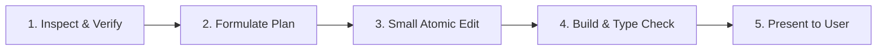

# AGENTS.md — Development Guidelines & Best Practices for AI Agents

Welcome to the **ShoeDZ (Pointure)** repository. This document defines the operational rules, engineering standards, and task-handling protocols for AI agents and human developers collaborating on this project.

---

## 1. Core Principles (Top Priorities)

> [!IMPORTANT]
> **1. Small, Incremental Changes Only**  
> Never perform wide, sweeping refactors or multi-screen rewrites in a single step. Break every feature, fix, or enhancement into small, self-contained, reviewable units.
> 
> **2. Strictly NO Auto-Commits**  
> **NEVER** run `git commit`, `git tag`, or `git push` automatically or proactively. Git commits and version tags must only be created when the user explicitly requests them. Always leave modified files staged or unstaged in the working tree for the user's review unless instructed otherwise.
> 
> **3. Strict Internationalization (i18n) — Zero Hardcoded Strings**  
> **NEVER** hardcode raw user-visible text in components, pages, forms, or modals. Every string displayed to the user must use `useTranslation()` (`t("section.key", "Default Fallback")`). Whenever UI is added or modified, all three locale files (`fr.json`, `ar.json`, `en.json`) must be updated and kept synchronized with appropriate RTL translations for Arabic.

---

## 2. Task Approach Protocol

Every task assigned to an agent must follow this lifecycle:



1. **Inspect & Verify**:
   - Read the relevant files before writing or suggesting code.
   - Search existing components and utilities to avoid reinventing already existing helpers (e.g., `@/lib/api`, `@/lib/phone`, `@/lib/printerConfig`, `@/lib/wilayas`).
2. **Formulate a Clear Plan**:
   - Break complex tasks into distinct phases or steps.
   - For multi-phase work, align with the user before touching code.
3. **Small Atomic Edits**:
   - Focus on one component, view, or endpoint at a time.
   - Preserve existing docstrings, comments, and unrelated functionality.
4. **Build & Type Check**:
   - Always verify TypeScript/build integrity after changes (`npm run build` runs `tsc --noEmit && vite build`):
     ```bash
     npx tsc --noEmit --prefix frontend
     npm run build --prefix frontend
     ```
   - For backend changes, verify Django health / syntax:
     ```bash
     python manage.py check  # or test
     ```
5. **Present & Review**:
   - Provide clickable file links using `[filename](file:///path/to/file)`.
   - Summarize exact changes concisely.
   - Ask for confirmation before moving to subsequent steps.

---

## 3. Architecture & Domain Guidelines

### Footwear Retail Domain (Algerian Context)
- **Currency & Numbers**: All prices are in Algerian Dinars (`DZD`). Use standard formatters (`formatDZD()`).
- **Phone Numbers**: Primary identifier for authentication and clients. Must adhere to standard Algerian mobile formats (`05`, `06`, `07`, or international `+213`). Always use `@/lib/phone` on frontend and `apps.core.utils.phone` on backend.
- **Footwear Sizing**: Sizes are EU standards (typically 35–46). Footwear can be sold by individual pairs (*rayon*) or complete cartons (*gros / demi-gros*).
- **Wilayas**: Support for 58 Algerian wilayas with both French and Arabic designations.

### Frontend Standards (React + TypeScript + Vite + Tailwind CSS)
- **Dark Mode Support**:
  - Every component must support both light and dark themes.
  - Follow the project color scheme: dark surfaces use `dark:bg-slate-900`, `dark:bg-slate-950`, dark borders use `dark:border-slate-800`, and muted text uses `dark:text-slate-400`.
  - Avoid hardcoded white backgrounds (`bg-white` must be paired with appropriate `dark:bg-...`).
- **Internationalization (i18n)**:
  - Three languages supported: French (`fr`, default), Arabic (`ar`, RTL), and English (`en`).
  - Text strings must use `useTranslation()` (`t("key")`).
  - Keep locale files (`fr.json`, `ar.json`, `en.json`) synchronized.
- **Tailwind & UI**:
  - Prefer standard utility classes (`btn-primary`, `card`, `form-input`, `form-label`).
  - Maintain clean spacing, proper focus states (`focus-visible:ring-2`), and mobile/desktop responsiveness.

### Backend Standards (Django + Django REST Framework)
- **Multi-Tenancy**:
  - Every business model belongs to a `Tenant`.
  - Always scope queries to `request.user.tenant`. Never allow cross-tenant data leaks.
- **Financial & Stock Transactions**:
  - Stock movements, sales, and payments must execute inside `@transaction.atomic`.
  - Maintain idempotency where possible.
- **Permissions & Roles**:
  - Respect role hierarchies (`owner`, `manager`, `cashier`).
  - Cashier accounts have restricted permissions (POS, shift reconciliation, limited settings).

### Desktop & Hardware Integration (Windows Standalone)
- **Hardware Agnostic**:
  - Support both direct ESC/POS thermal printing (80mm/58mm via USB/network) and standard Windows OS printer dialogs.
  - Test print helpers are centralized in [`frontend/src/lib/printerConfig.ts`](file:///Users/admin/Github/pointure/frontend/src/lib/printerConfig.ts).
- **Barcode Scanners**:
  - Support standard USB HID keyboard-wedge scanners (instant barcode input followed by Enter).

---

## 4. Git & Workflow Rules

| Rule | Enforcement |
| :--- | :--- |
| **No Auto-Commits** | **Strictly prohibited**. Only run `git commit` when explicitly instructed with a message or confirmation from the user. |
| **No Auto-Tagging** | Do not create Git tags (`git tag vX.Y.Z`) unless explicitly requested. |
| **No Forced Pushes** | Never force-push (`git push --force`) to remote branches. |
| **Clean Diffs** | Review `git status` and `git diff` to ensure no transient files, test artifacts, or stray console logs are committed. |

---

## 5. Agent Checklist Before Concluding Any Step

- [ ] Has the change addressed *only* the specific scope requested?
- [ ] Are all user-facing strings using `t(...)` and synchronized across `fr.json`, `ar.json`, and `en.json`?
- [ ] Are TypeScript and build checks passing with zero errors?
- [ ] Is dark mode verified on any modified UI component?
- [ ] Have all git commits been deferred until the user requests them?
- [ ] Are all referenced files linked with clickable paths?